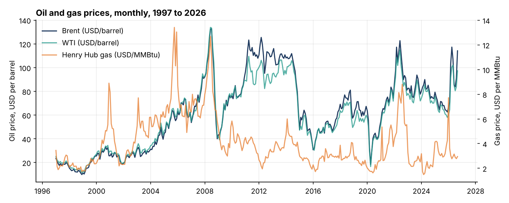
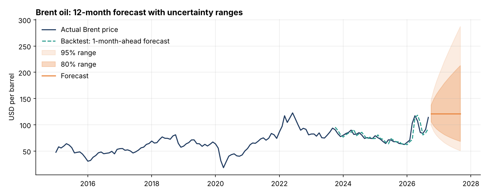
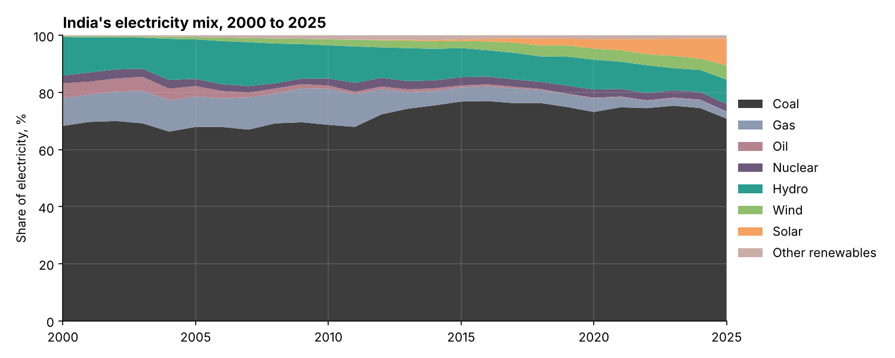

# Energy Market Pulse

A small end-to-end energy analytics project: **Python → SQL database → forecasting → Power BI dashboard.**

It answers three simple questions with real public data:

1. How have **oil and gas prices** moved since 1997, and when were the biggest shocks?
2. Can a statistical model forecast **Brent oil** better than "next month = this month"? And can we trust its uncertainty ranges?
3. How is **India's electricity mix** changing as demand grows?



---

## Key findings

- **Oil prices are very hard to forecast.** The best model by AIC, ARIMA(0,1,1), had **6.33% error (MAPE)** on 1-month-ahead forecasts over the last 36 months. The simple naive forecast had **6.65%**. So the model is only slightly better. The real value is in the **uncertainty range**, not the single number.
- **The model's ranges were too cautious.** Its "80% range" contained the real price **91.7%** of the time in the backtest, so the ranges were wider than they needed to be.
- **2026 brought some of the biggest oil moves in the data.** March 2026 (+45.5%) and September 2026 (+25.3%) rank among the 10 largest monthly Brent moves since 1997, next to the 2008 crash and the 2020 COVID shock.
- **The Brent–WTI gap widened sharply in 2026.** It averaged about $4 per barrel in 2015–2025, but reached about **$17** in April and September 2026.
- **India still runs mainly on coal, but solar is rising fast.** Coal gave **70.8%** of India's electricity in 2025. Solar went from **0% in 2000 to 9.4% in 2025**, and wind reached 5.0%. Total demand grew about **3.6 times**, from 573 TWh to 2,083 TWh.





---

## How it works

| Step | File | What it does |
|---|---|---|
| 1 | `01_get_data.py` | Downloads 4 public CSV files |
| 2 | `02_clean_and_load.py` | Cleans the data, runs quality checks, loads it into a SQL database (`data/energy.db`) |
| 3 | `queries.sql` + `03_run_sql.py` | 5 SQL questions (yearly averages, Brent–WTI spread, biggest moves, mix change, demand growth) using `GROUP BY`, self-joins, CTEs and window functions (`LAG`) |
| 4 | `04_forecast.py` | Picks an ARIMA model by AIC, backtests it against a naive forecast, checks range coverage, makes a 12-month forecast with 80% and 95% ranges, and exports files for Power BI |
| 5 | `05_make_charts.py` | Makes the preview charts shown above |
| – | `POWERBI_GUIDE.md` | Step-by-step guide to build the 2-page Power BI dashboard |

### Data quality checks (step 2)
- No missing prices, no zero or negative prices
- No duplicate months for any benchmark
- India's electricity shares add up to about 100% in every year

## Run it

```bash
pip install -r requirements.txt
python 01_get_data.py
python 02_clean_and_load.py
python 03_run_sql.py
python 04_forecast.py
python 05_make_charts.py
```
Then open Power BI Desktop and follow `POWERBI_GUIDE.md`.

## Data sources
- Brent and WTI monthly prices: [datasets/oil-prices](https://github.com/datasets/oil-prices) (from the US Energy Information Administration)
- Henry Hub natural gas monthly prices: [datasets/natural-gas](https://github.com/datasets/natural-gas) (from the US EIA)
- India electricity mix and demand: [Our World in Data energy dataset](https://github.com/owid/energy-data)

## Tools
Python (pandas, NumPy, statsmodels, matplotlib) · SQL (SQLite) · Power BI
